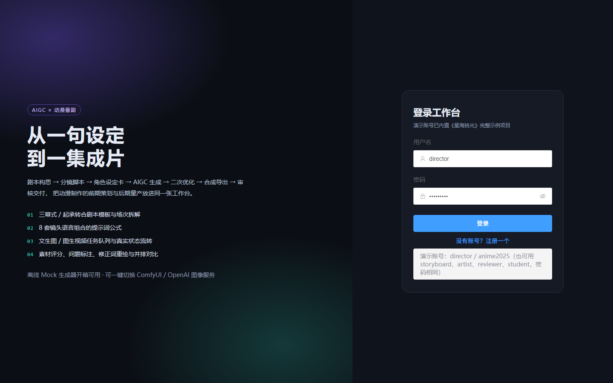
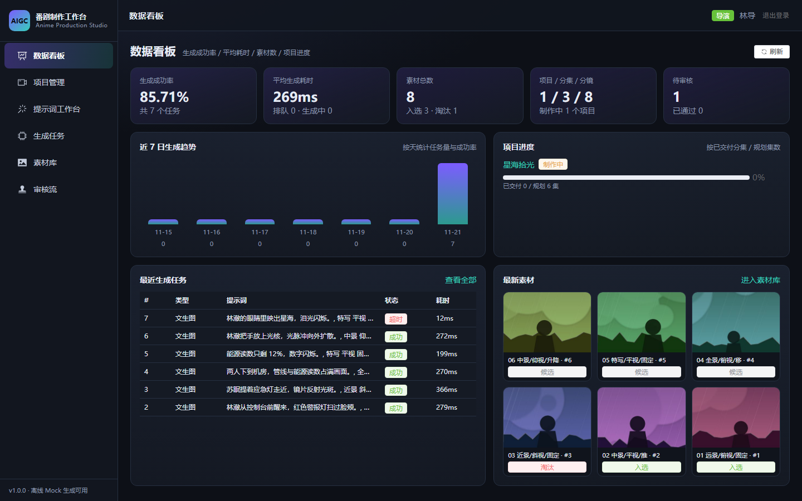
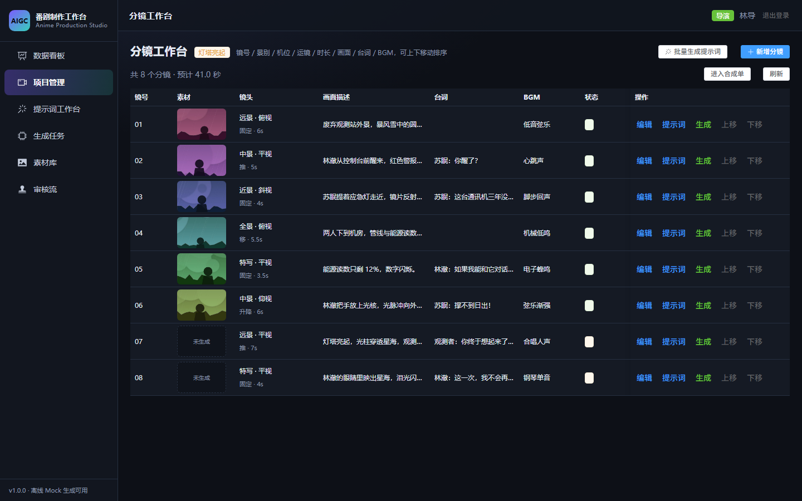
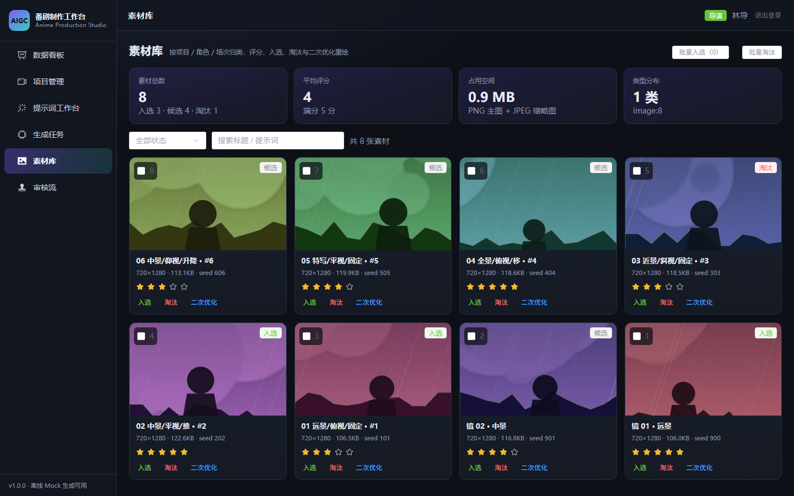
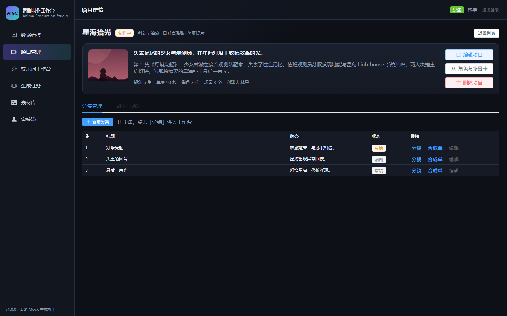
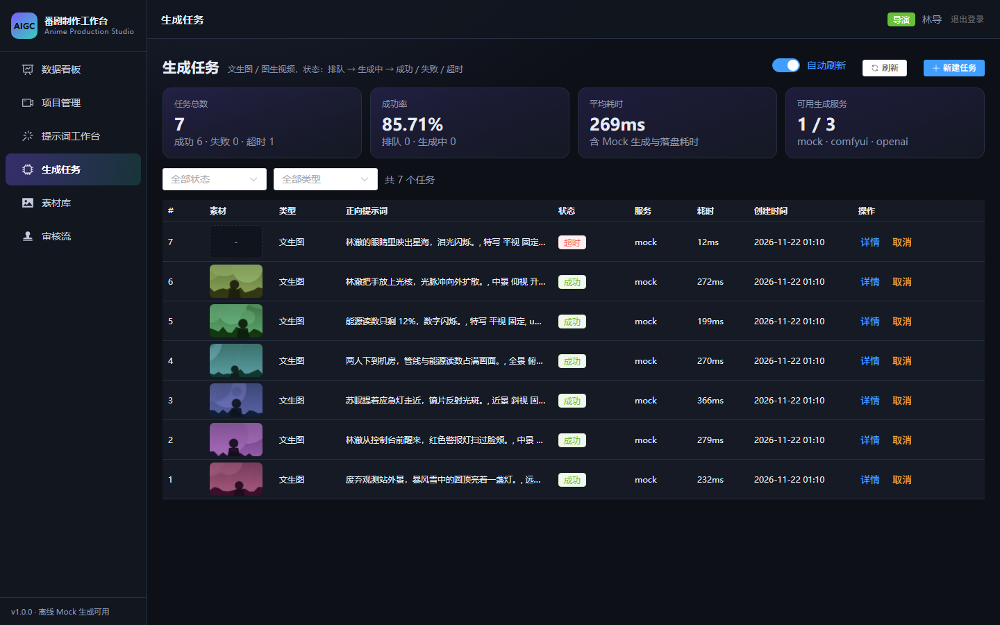
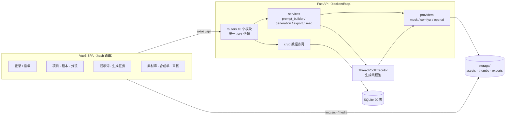

# AIGC 动漫番剧制作工作台

> 把「一句设定」变成「一集成片」的 AIGC 动漫制作工作台：剧本 → 分镜 → 角色设定卡 → 提示词构建 → 文生图/图生视频任务 → 素材二次优化 → 成片合成单导出 → 审核流 → 数据看板。

```
Python 3.11 · FastAPI · SQLAlchemy 2 · SQLite   |   Vue 3 · Vite · TypeScript · Element Plus   |   pytest 42 passed   |   MIT
```

## 界面预览

| 登录 / 角色入口 | 数据看板 |
|---|---|
|  |  |

| 分镜工作台（8 个分镜 + 真实生成缩略图） | 素材库（评分 / 入选 / 淘汰 / 二次优化） |
|---|---|
|  |  |

| 项目详情（分集 + 剧本 + 场次） | 生成任务（排队 → 生成中 → 成功 / 超时） |
|---|---|
|  |  |

> 截图由 `backend/scripts/capture_screenshots.py` 用 Edge 无头模式对真实运行中的系统拍摄（1440×900），数据来自种子剧集《星海拾光》与 mock 生成器的真实渲染结果。

## 为什么做这个项目

我关注到宜宾澎湃人工智能科技有限公司的「AI 专项训练师（AIGC 动漫方向）」岗位：职责不是"会写提示词"，而是**把 AIGC 工具真正嵌进动漫制作流水线**——参与前期策划（剧本构思、分镜脚本、角色设定），用 AIGC 生成动画素材与短视频/番剧片段，再对生成内容做二次优化保证成片质量。

实际做作品时我发现两个问题：

1. **网上的 AIGC Demo 大多是"输入一句话、出一张图"**，没有项目、分集、分镜、剧本的结构，脱离真实制作流程；
2. **真实团队的工作留痕全靠聊天记录和文件夹**，同一角色在不同镜头里长得不一样、素材选完就找不到原提示词、审核意见口头传达。

所以我做了这个工作台：把动漫制作的**前期策划 → 素材生成 → 二次优化 → 合成交付 → 审核**整条链路结构化。它默认使用**离线 mock 生成器**（PIL 本地渲染，按 prompt+seed 确定性出图），`git clone` 后不需要 GPU、不需要任何 API Key 就能跑通完整流程；同时留好了 ComfyUI / OpenAI 图像接口的适配层，配置环境变量即可切到真实生成服务。

## 功能清单

- [x] **登录注册**：JWT + PBKDF2 密码哈希，5 种角色（导演 / 分镜师 / 美术 / 审核 / 学员）
- [x] **项目管理**：番剧 / 短片，题材、集数、目标时长、画风、竖屏或横屏、状态机
- [x] **剧本管理**：按集保存多版本（v1..vN，只有一版为当前版），三套结构模板（三幕式 / 起承转合 / 自由）
- [x] **场次表**：地点、时间、人物、动作、对白、情绪、时长，支持上移下移
- [x] **分镜脚本**：镜号、景别、机位、运镜、时长、画面描述、台词、BGM，支持整体重排
- [x] **角色设定卡**：性格、外形提示词、一致性前缀、参考图、LoRA 名与权重、固定 seed、声线
- [x] **场景设定卡**：氛围、提示词、seed，与角色卡一起保证跨镜头一致性
- [x] **提示词构建器**：主体 + 动作 + 镜头语言 + 画风 + 光影 + 画质词 + 负向词，逐段可见、可复用；内置 12 套画风模板
- [x] **AIGC 生成任务**：文生图 / 图生视频，状态 `queued → running → succeeded / failed / timeout / canceled`，支持轮询、取消、重试
- [x] **三种生成服务**：`mock`（离线可跑，默认）、`comfyui`（本地 GPU 工作流）、`openai`（云端图像接口）
- [x] **素材库**：按项目 / 角色 / 场次 / 镜头筛选，重命名、1-5 星评分、入选 / 淘汰、批量操作
- [x] **二次优化**：标注 8 类问题（手部崩坏、脸部崩坏、构图、色偏、多余肢体、模糊、文字伪影、风格漂移）→ 自动追加英文修正词 → 重绘 → 新旧素材链路留痕
- [x] **成片合成单**：按顺序的镜头清单（素材、字幕、时长、转场、音频备注）、自动填充、导出 CSV / JSON / SRT / ZIP 与导出历史
- [x] **成片质检清单**：8 项检查项勾选并记录检查人
- [x] **审核流**：提交 → 通过 / 驳回（必填意见）→ 状态流转，全程留痕
- [x] **数据看板**：生成成功率、平均耗时、素材数、项目进度、近 7 日趋势、最近任务与最新素材
- [x] **工程化**：统一响应体与异常、`X-Request-Id` 链路、Swagger 文档、42 个 pytest 用例、`docker-compose.yml` 与前端构建
- [ ] 图生视频真实生成（当前 mock 产出单帧占位，真实视频需接 AnimateDiff/SVD + ffmpeg，见 roadmap）
- [ ] 多租户与配额（当前所有登录用户共享数据，未做数据级权限隔离）

## 技术栈

| 层次 | 技术选型 | 说明 |
|---|---|---|
| 后端框架 | Python 3.11 + FastAPI 0.118 | 全异步路由、自动 OpenAPI 文档 |
| ORM | SQLAlchemy 2.0（`Mapped` 声明式） | 20 张表，SQLite 默认，可切 PostgreSQL/MySQL |
| 校验 | Pydantic v2 | 枚举校验（景别/机位/运镜/状态）、长度限制 |
| 鉴权 | PyJWT（HS256）+ PBKDF2-SHA256 | token 12 小时，密码 12 万轮加盐 |
| 生成执行 | `ThreadPoolExecutor` + 数据库状态机 | 任务排队、进度、超时、重启回收，无需 Redis/Celery |
| 图像渲染 | Pillow 11+ | mock provider 离线渲染占位图与缩略图 |
| 测试 | pytest 8 + httpx TestClient | 42 个用例，临时 SQLite，覆盖全链路 |
| 前端框架 | Vue 3.5 + TypeScript 5.6 + Vite 6 | hash 路由（静态托管零配置） |
| UI | Element Plus 2.9 + 自定义暗色工作室主题 | 表格 / 抽屉 / 弹窗 / 上传 / 进度条 |
| 状态与请求 | Pinia + axios 封装 | token 持久化、统一错误提示、文件流下载 |
| 部署 | Docker Compose（PostgreSQL + uvicorn + nginx） | 本机未装 Docker，方案见 docs/deployment.md |

## 系统架构



生成链路：`POST /api/generation/tasks` → 落库 `queued` → 线程池取任务置 `running` → provider 真实渲染 → 落盘 PNG/JPEG → 建 `asset` → 回写 `task.asset_id` / `shot.asset_id` / 项目封面 → 前端 4 秒轮询拿结果。超过 `GENERATION_DEADLINE_SECONDS` 判 `timeout`；服务重启时残留 `running` 任务自动置 `failed` 可重试。

更详细的分层说明、提示词流水线、状态机与设计取舍见 [docs/architecture.md](docs/architecture.md)。

## 目录结构

```
aigc-anime-production-studio/
├── backend/
│   ├── app/
│   │   ├── main.py            # FastAPI 入口：中间件、异常、路由挂载、静态资源
│   │   ├── config.py          # 环境变量与路径配置
│   │   ├── database.py        # 引擎、会话、PRAGMA、建表
│   │   ├── models.py          # 20 张表的 ORM 模型
│   │   ├── schemas.py         # Pydantic v2 请求模型
│   │   ├── deps.py            # JWT 依赖、角色校验、分页参数
│   │   ├── errors.py          # 统一响应体与异常处理
│   │   ├── security.py        # PBKDF2 哈希 + JWT 签发/校验
│   │   ├── constants.py       # 画风预设、镜头语言词表、质检项、问题项
│   │   ├── serializers.py     # ORM → 前端 JSON
│   │   ├── routers/           # auth/meta/series/storyboard/generation/assets/
│   │   │                      # composition/reviews/dashboard
│   │   ├── services/          # prompt_builder、generation、export_service、seed
│   │   │   └── providers/     # base/mock/comfyui/openai 适配层
│   │   └── crud/              # 查询函数（series/production/assets/common）
│   ├── scripts/               # 冒烟、截图、种子增强、DB 导出
│   ├── tests/                 # 42 个 pytest 用例（API 全链路）
│   ├── requirements.txt
│   └── Dockerfile
├── frontend/
│   ├── src/
│   │   ├── api/               # axios 实例 + 各领域 API + 文件下载
│   │   ├── components/        # AppLayout 布局
│   │   ├── router/            # hash 路由与登录守卫
│   │   ├── stores/            # Pinia 登录态
│   │   ├── styles/            # 暗色工作室主题
│   │   ├── utils/             # 格式化工具
│   │   └── views/             # 11 个页面：登录/看板/项目/项目详情/分镜/
│   │                          # 合成单/角色卡/提示词/生成任务/素材/审核
│   ├── vite.config.ts
│   ├── nginx.conf
│   └── Dockerfile
├── db/                        # schema.sql（DDL）、seed.sql（示例数据）、init.sql
├── docs/                      # 需求/架构/数据库/接口/部署/路线/生产流水线 + screenshots
├── docker-compose.yml
├── .env.example
├── LICENSE
└── README.md
```

## 快速开始

环境：Windows 10/11 + PowerShell、Python 3.11、Node 20+（本项目实测 Python 3.11.9 / Node 24.20）。数据库用内置 SQLite，无需安装。

### 1. 后端（一条命令起服务）

```powershell
cd backend
python -m pip install -r requirements.txt
$env:PYTHONIOENCODING='utf-8'
python -m uvicorn app.main:app --host 127.0.0.1 --port 8000
```

首次启动自动建表 + 写入种子数据（5 个账号、示例剧集《星海拾光》：3 集 / 3 场 / 8 分镜 / 3 角色卡 / 3 场景卡 / 合成单 / 质检清单 / 待审记录），并启动生成线程池。

验证：

```powershell
curl.exe -s http://127.0.0.1:8000/health
# {"code":0,"message":"ok","data":{"status":"ok","app":"AIGC 动漫番剧制作工作台","version":"1.0.0",...}}
```

接口文档：<http://127.0.0.1:8000/docs>

### 2. 前端

```powershell
cd frontend
npm install            # PowerShell 里若 npm 被执行策略拦截，用 npm.cmd
npm run dev            # http://127.0.0.1:5173
```

生产构建与单端口演示（构建产物会被后端直接托管）：

```powershell
npm run build          # 产物 frontend/dist
# 回到 backend 目录重启后端后访问 http://127.0.0.1:8000/#/
```

### 3. 一键演示脚本

```powershell
cd backend
python scripts\smoke_test.py          # 端到端冒烟：立项→剧本→分镜→生成→素材→合成单→审核
python scripts\seed_demo_activity.py  # 给演示项目补 6 条真实生成任务与素材（含 1 条超时）
python scripts\capture_screenshots.py # 用 Edge 无头模式重拍 docs/screenshots
```

### 4. 切换真实生成服务（可选）

```powershell
# ComfyUI（本地 SD/SDXL）
$env:COMFYUI_BASE_URL = "http://127.0.0.1:8188"
$env:COMFYUI_WORKFLOW_PATH = "D:\ai\workflows\anime_t2i_api.json"
# 或 OpenAI 兼容图像接口
$env:OPENAI_API_KEY = "sk-..."
```

详见 [docs/deployment.md](docs/deployment.md)。

## 默认账号

| 用户名 | 密码 | 角色 | 用途 |
|---|---|---|---|
| `director` | `anime2025` | 导演 | 全部权限，负责立项、审片 |
| `storyboard` | `anime2025` | 分镜师 | 剧本、分镜、场次 |
| `artist` | `anime2025` | 美术 | 角色卡、场景卡、素材生成 |
| `reviewer` | `anime2025` | 审核 | 审核流决策 |
| `student` | `anime2025` | 学员 | 只读学习（当前与其他人共享数据，未做数据隔离） |

> 演示便捷入口：登录页地址加 `?demo=1`（如 `http://127.0.0.1:8000/#/login?demo=1&next=/dashboard`）会用 `director` 自动登录并跳转到目标页。

## 主要接口

完整契约见 [docs/api.md](docs/api.md)，交互式文档在 `/docs`。统一响应体 `{code,message,data,request_id}`，除登录注册与元数据外都需要 `Authorization: Bearer <token>`。

| 分组 | 接口 |
|---|---|
| 认证 | `POST /api/auth/register`、`POST /api/auth/login`、`GET /api/auth/me` |
| 元数据 | `GET /api/meta/options`（画风/景别/机位/运镜/状态/质检项等） |
| 项目 | `GET/POST /api/series`、`GET/PATCH/DELETE /api/series/{id}` |
| 分集/剧本/场次 | `GET/POST /api/series/{id}/episodes`、`GET/PUT /api/episodes/{id}/script`、`GET/POST /api/episodes/{id}/scenes`、`POST /api/scenes/{id}/move` |
| 分镜 | `GET/POST /api/episodes/{id}/shots`、`PATCH/DELETE /api/shots/{id}`、`POST /api/shots/{id}/move`、`POST /api/episodes/{id}/shots/reorder`、`POST /api/shots/{id}/prompt` |
| 角色/场景 | `GET/POST /api/series/{id}/characters`、`GET/POST /api/series/{id}/scene-cards` |
| 提示词 | `POST /api/prompts/build`、`GET/POST /api/prompts/templates`、`GET /api/prompts/history`、`GET /api/prompts/issues` |
| 生成 | `GET /api/generation/providers`、`POST /api/generation/tasks`、`GET /api/generation/tasks/{id}`、`POST .../cancel`、`POST .../retry`、`GET /api/generation/stats` |
| 素材 | `GET /api/assets`、`GET /api/assets/stats`、`PATCH /api/assets/{id}`、`POST /api/assets/{id}/rate`、`POST /api/assets/{id}/revise`、`POST /api/assets/batch` |
| 合成单 | `GET/PUT /api/episodes/{id}/timeline`、`POST /api/episodes/{id}/timeline/auto-fill`、`PATCH /api/timeline-items/{id}`、`GET /api/episodes/{id}/export?format=csv\|json\|srt\|zip`、`GET /api/episodes/{id}/checklist` |
| 审核 | `GET/POST /api/reviews`、`POST /api/reviews/{id}/decide`、`GET /api/reviews/stats` |
| 看板 | `GET /api/dashboard/overview`、`GET /api/dashboard/trend?days=7` |

典型调用（PowerShell）：

```powershell
$login = curl.exe -s -X POST http://127.0.0.1:8000/api/auth/login -H "Content-Type: application/json" -d '{\"username\":\"director\",\"password\":\"anime2025\"}' | ConvertFrom-Json
$token = $login.data.token
curl.exe -s "http://127.0.0.1:8000/api/episodes/1/shots" -H "Authorization: Bearer $token"
```

## 测试

```powershell
cd backend
python -m pytest -q
```

真实结果（2025-11-22 本机实测）：

```
........................................                                  [100%]
42 passed in 22.07s
```

- 用例文件：`backend/tests/test_auth_projects.py`（24 个，认证/项目/剧本/场次/分镜/角色/场景卡/提示词/元数据）与 `backend/tests/test_production_flow.py`（18 个，生成任务成功/超时/未知服务/取消/重试、素材评分与二次优化、合成单与四种导出、质检、审核流转、看板）。
- 测试隔离：`conftest.py` 在导入应用前把 `DATABASE_URL` 指到临时目录的 SQLite，`GENERATION_INLINE=1` 让生成同步执行，每个测试都用独立临时库，不污染开发数据。

前端构建验证：

```powershell
cd frontend
npm run build
# dist/index.html + 分页面产物，✓ built in 1m 2s
```

端到端冒烟（真实运行中的服务，非 mock 断言）：

```
[1] /health -> ok · AIGC 动漫番剧制作工作台 v1.0.0 · providers=[mock(可用), comfyui(未配置), openai(未配置)]
[9] 提交生成任务 #3：queued
    轮询 #3 -> running（15%）
    轮询 #3 -> succeeded（100%）
[10] 任务结束：succeeded，耗时 241ms，素材 #5
[13] 二次优化：追加修正词 -> ...'sharp focus, high resolution, crisp line art'；重绘任务 #4=succeeded，新素材 #6
[14] 合成单「第 1 集 · 成片合成单」镜头 1 个、总时长 6.0s
[15] 导出 CSV 285 字节；表头：序号,镜号,景别,机位,运镜,时长(秒),画面描述,台词/字幕,转场,BGM/音效,素材文件
[17] 审核 #2：pending -> approved，审核人 林导
[18] 看板：项目 4、分集 6、分镜 11、素材 6、成功率 100.0%、平均耗时 550ms、趋势点 7 个
```

## 与岗位要求的对应关系

| # | 岗位职责 | 本项目实现 | 关键文件 |
|---|---|---|---|
| 1 | 掌握主流 AIGC 工具在动漫制作中的应用 | 统一 provider 适配层（mock / ComfyUI / OpenAI 图像接口）+ 12 套画风模板 + 提示词公式 | `backend/app/services/providers/base.py`、`providers/mock.py`、`providers/comfyui.py`、`providers/openai.py`、`backend/app/constants.py`、`backend/app/services/prompt_builder.py` |
| 2 | 参与前期策划：剧本构思、分镜脚本、角色设定 | 剧本多版本 + 场次表；分镜（景别/机位/运镜/时长/台词/BGM/排序）；角色卡（性格/外形 prompt/LoRA/seed）；场景卡 | `backend/app/routers/series.py`、`backend/app/routers/storyboard.py`、`frontend/src/views/SeriesDetailView.vue`、`StoryboardView.vue`、`CharactersView.vue` |
| 3 | 用 AIGC 生成动画素材、短视频及番剧片段 | 生成任务队列与状态机、轮询接口、取消重试、素材库归属、成片合成单与 CSV/JSON/SRT/ZIP 导出 | `backend/app/services/generation.py`、`backend/app/routers/generation.py`、`backend/app/services/export_service.py`、`backend/app/routers/composition.py` |
| 4 | 对生成内容二次优化，保证成片质量 | 素材评分与入选/淘汰、8 类问题标注 → 自动追加修正词 → 重绘 → 留痕、成片质检清单、审核流通过/驳回 | `backend/app/routers/assets.py`、`backend/app/services/prompt_builder.py`（`fix_prompt`）、`backend/app/routers/reviews.py`、`frontend/src/views/AssetsView.vue` |
| 5 | 项目管理、团队协作与交付演示 | 项目状态机与看板、角色权限字段、`X-Request-Id` 链路、Swagger 文档、冒烟脚本与截图脚本、Docker Compose 部署方案 | `backend/app/routers/dashboard.py`、`backend/app/main.py`、`backend/scripts/smoke_test.py`、`backend/scripts/capture_screenshots.py`、`docker-compose.yml`、`docs/deployment.md` |

生产视角的流水线对照（每个环节是自动化还是人工、真实工具怎么接）见 [docs/production-workflow.md](docs/production-workflow.md)。

## 后续规划

- **v1.1 体验**：素材并排对比（原图/重绘图滑动 + 差值高亮）、分镜批量生成、剧本 AI 辅助起草、素材回收站。
- **v1.2 工程化**：Alembic 迁移、生成任务迁 Celery/Redis 支持多机与优先级、`/media` 私有化签名 URL、操作审计日志、OpenTelemetry 全链路追踪。
- **v2.0 生产能力**：图生视频真实接入（AnimateDiff / SVD）+ ffmpeg 按合成单自动串片出 MP4、LoRA 训练任务登记与 IP-Adapter 参考图链路、多租户与配额计费、移动端适配。

完整清单见 [docs/roadmap.md](docs/roadmap.md)。

## 文档

| 文档 | 内容 |
|---|---|
| [docs/requirements.md](docs/requirements.md) | 岗位背景、需求分析、JD 逐条映射、验收记录 |
| [docs/architecture.md](docs/architecture.md) | 分层架构、时序图、提示词流水线、生成状态机、设计取舍 |
| [docs/database.md](docs/database.md) | 20 张表设计、ER 图、约束与一致性、备份与迁移 |
| [docs/api.md](docs/api.md) | 全部接口契约、错误码、请求示例 |
| [docs/deployment.md](docs/deployment.md) | 本机运行、环境变量、切换真实 AIGC、Docker、常见问题 |
| [docs/production-workflow.md](docs/production-workflow.md) | 真实动漫生产流水线与平台覆盖度对照 |
| [docs/roadmap.md](docs/roadmap.md) | 版本规划与已知限制 |

## License

[MIT](LICENSE) © 2025 zhoushiba
