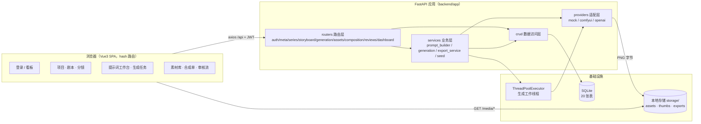
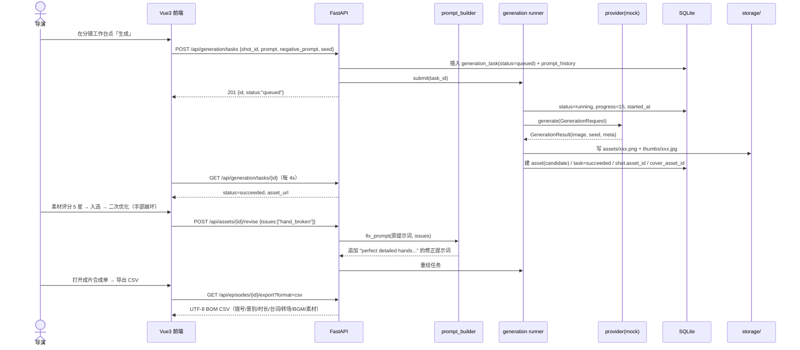
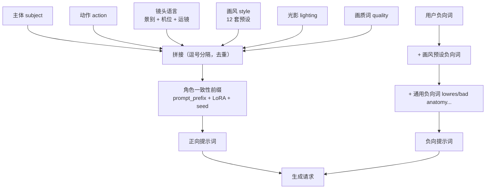
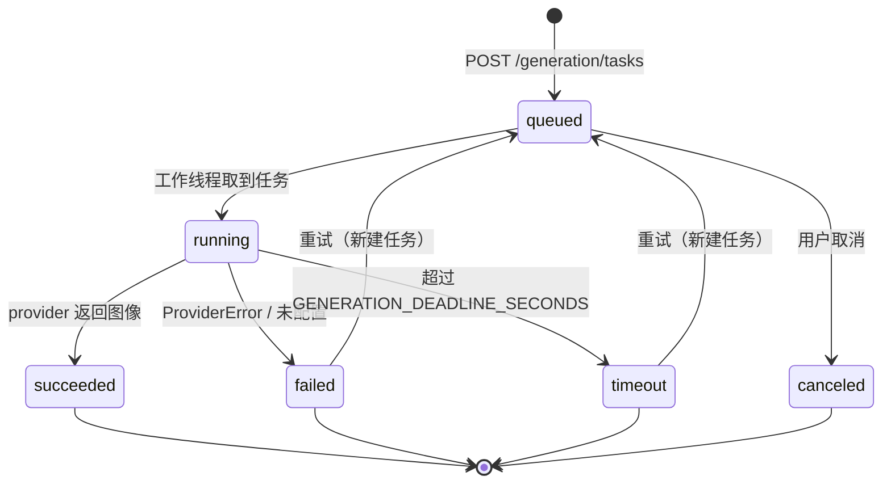

# 系统架构（architecture.md）

## 1. 总体结构

要点：

- **分层**：`routers`（协议与校验，`deps.py` 注入当前用户）→ `services`（业务编排）→ `crud`（SQLAlchemy 查询）→ `models`（ORM）。路由里不写 SQL，服务里不碰 HTTP。
- **生成是异步的**：`services/generation.py` 用 `ThreadPoolExecutor` 跑任务，任务状态写回数据库，前端 4 秒轮询 `GET /api/generation/tasks/{id}`。测试与演示可开 `GENERATION_INLINE=1` 同步执行。
- **静态资源**：素材落盘到 `storage/assets/`，通过 `/media` 静态挂载回传；`frontend/dist` 存在时后端同时托管前端（单端口演示）。

## 2. 一次「分镜 → 成片合成单」的数据流

## 3. 提示词构建流水线

`build_prompt()` 返回结构化结果（`parts` 里逐段可见），前端提示词工作台把它原样展示，方便教学与复用。

## 4. 生成状态机

服务重启时 `runner.warmup()` 把残留的 `running` 任务标记为 `failed`（错误信息「服务重启，任务中断，请重试」），避免出现永远转圈的任务。

## 5. 目录与职责

| 目录 | 职责 |
|---|---|
| `backend/app/routers/` | 10 个路由模块，统一 `prefix=/api`，业务路由统一挂 `Depends(get_current_user)` |
| `backend/app/services/` | 提示词构建、生成执行器、导出、种子数据；`providers/` 是 AIGC 适配层 |
| `backend/app/crud/` | 纯查询函数，返回 `Select` 或实体，供路由分页复用 |
| `backend/app/models.py` | 20 张表的 SQLAlchemy 2.0 声明式模型 |
| `backend/app/schemas.py` | Pydantic v2 请求模型（枚举校验、长度限制） |
| `frontend/src/views/` | 11 个页面视图（登录/看板/项目/项目详情/分镜/合成单/角色/提示词/任务/素材/审核） |
| `frontend/src/api/` | axios 实例 + 各领域 API 封装 + 文件下载封装 |

## 6. 设计取舍

| 决策 | 原因 |
|---|---|
| 生成默认用 `mock` provider | 作品集必须 `clone → 跑起来`，不能依赖 GPU 或云端 Key；mock 用 PIL 真实渲染 PNG（渐变天空、光斑、速度线、剪影、信息带），同一 seed+prompt 结果确定，便于测试断言 |
| 生成走线程池而非 Celery | 目标环境无 Redis/RabbitMQ；`ThreadPoolExecutor` + 数据库状态足够表达排队/运行/超时，且测试无需额外服务 |
| SQLite 作为默认库 | 免安装、文件级备份；ORM 层不写方言特有 SQL，切 PG/MySQL 只需换 `DATABASE_URL` |
| 前端不引 echarts | 趋势图用 CSS 柱状图即可满足看板表达，减少 1MB 级依赖与构建风险 |
| 审核用「提交-决策」两态而非复杂工作流引擎 | 动漫制作的实际审核是「分集/素材送审 → 导演或审核通过/驳回」，两态 + 意见 + 留痕已覆盖 |
