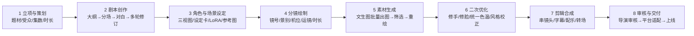

# 生产流水线对照（production-workflow.md）

本文件说明：一个真实的 AIGC 动漫番剧项目，从立项到成片会经过哪些环节，以及本项目在每个环节里承担什么角色、哪些环节还是人工/AI 外部工具完成的。目的是让平台贴合真实生产，而不是做一个「点了按钮出图」的玩具。

## 1. 真实流水线（8 个阶段）

## 2. 平台覆盖度

| 阶段 | 真实做法 | 平台内对应功能 | 是否自动化 |
|---|---|---|---|
| 1 立项策划 | 制片与导演定题材、集数、时长、投放平台 | 项目管理：题材/集数/目标时长/画风/形态（竖屏短片 or 横屏番剧）/状态机 | 记录与看板 |
| 2 剧本创作 | 编剧写大纲 → 三幕式分场 → 打磨对白 | 剧本版本管理（每次保存 v1..vN，保留历史）、场次表（地点/时间/人物/动作/对白/情绪/时长）、三套结构模板 | 结构模板 + 人工创作 |
| 3 角色与场景设定 | 美术画三视图、定配色、训练 LoRA | 角色设定卡（性格/外形提示词/一致性前缀/LoRA 名与权重/固定 seed/声线）、场景卡（氛围/提示词/seed） | 人工设定 + 提示词结构化 |
| 4 分镜绘制 | 分镜师按剧本画分镜 | 分镜脚本：镜号/景别/机位/运镜/时长/画面描述/台词/BGM；上移下移与整体重排 | 人工 + 时间估算 |
| 5 素材生成 | 用 SD/Midjourney 按提示词批量出图 | 提示词构建器（7 段公式 + 12 画风模板）+ 生成任务队列 + 轮询 + 取消/重试 | **自动**（mock 离线 / ComfyUI / 云端） |
| 6 二次优化 | 挑图、标问题、局部重绘或换 seed 重出 | 素材评分（1-5）、入选/淘汰、8 类问题标注 → 自动追加修正词 → 重绘 → 新旧素材链路留痕 | **半自动**（问题→修正词自动，重绘可自动） |
| 7 剪辑合成 | PR/达芬奇按合成单串镜头、烧字幕、配乐 | 成片合成单：镜头清单（素材/字幕/时长/转场/音频备注）、自动填充、CSV/JSON/SRT/ZIP 导出、8 项质检清单 | 导出交付给剪辑工具（不内置 ffmpeg） |
| 8 审核交付 | 导演/甲方审核，驳回改稿 | 审核流：提交 → 通过 / 驳回（必填意见）→ 状态流转，留痕可追溯 | 流程在线化 |

## 3. 典型一天的工作流（演示脚本）

1. **导演**登录 → 看板看到「《星海拾光》第 1 集」进行中，2 个分镜已出图、1 条待审。
2. 打开项目详情 → 「剧本与场次」确认第 1 集三场戏（观测站初醒 28s / 灯塔控制台 32s / 最后一束光 30s），如需修改直接编辑，保存即生成 v2 版本。
3. 进入「分镜工作台」→ 8 个分镜按 SH01..SH08 排列；对第 3 镜点「提示词」，看到自动拼好的正向/负向提示词（含角色前缀 `lin_che_v1` 与场景「废弃观测站」）。
4. 点「生成」→ 任务进入 `queued`，4 秒后变 `running`，再几秒 `succeeded`，缩略图出现在分镜行首。
5. 切到「素材库」→ 勾选候选图、打 5 星、点「入选」；发现手部崩坏就点「二次优化」，勾选「手部崩坏」提交 → 系统自动在提示词后追加 `perfect detailed hands, five fingers...` 并重绘，新素材与原素材都可追溯。
6. 进入「成片合成单」→ 检查镜头顺序、补字幕、把第 3、6 镜转场改成「叠化」→ 勾选质检清单 8 项 → 导出 CSV 交给剪辑。
7. 点「提交审核」→ 审核人（reviewer 账号）在「审核流」看到待审，填意见驳回或通过；驳回后分镜状态回到待改。
8. 完整闭环后，看板上的成功率、平均耗时、素材数、项目进度就是这一天的产出。

## 4. 与真实 AIGC 工具的衔接

| 环节 | 真实工具 | 本项目接入方式 |
|---|---|---|
| 出图 | Stable Diffusion / ComfyUI / SDXL | `COMFYUI_BASE_URL` + API 格式工作流 JSON，provider 选 `comfyui` |
| 云端出图 | GPT-Image / 通义万相 / 即梦 | 任一 OpenAI 兼容 `/images/generations`，provider 选 `openai` |
| 视频 | AnimateDiff / SVD / 可灵 | v2.0 计划：新增 `video` provider 与 ffmpeg 串片 |
| 角色一致性 | LoRA / IP-Adapter / ControlNet | 角色卡记录 LoRA 名与权重、参考图、固定 seed，提示词自动带一致性前缀 |
| 剪辑 | Premiere / 达芬奇 / CapCut | 导出合成单 CSV/JSON + SRT 字幕，直接进剪辑软件 |

## 5. 质量把控的三个抓手

1. **提示词规范化**：7 段公式固定下来，新人照填也能出可用图，避免「一句话许愿式提示词」。
2. **问题→修正词闭环**：8 类常见问题（手/脸/构图/色偏/多余肢体/模糊/文字伪影/风格漂移）各自绑定英文修正词，人工只负责标注问题，修正动作标准化。
3. **留痕与审核**：任务、素材、二次优化、审核意见全部入库；出现「这版是谁改的、为什么改」时能查到。
